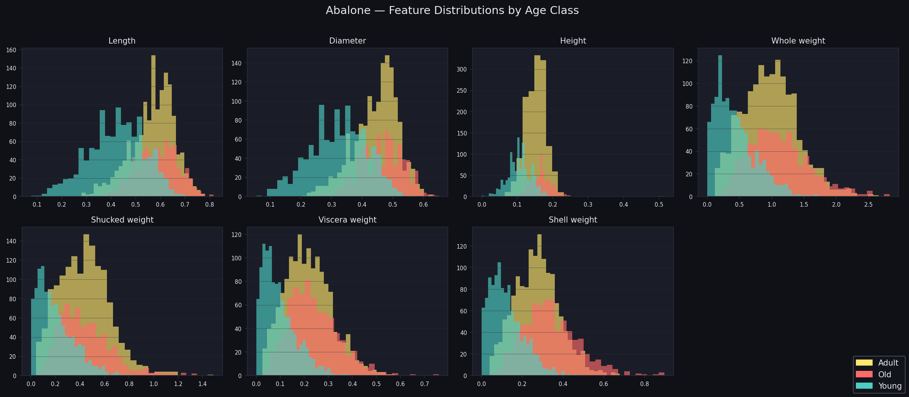
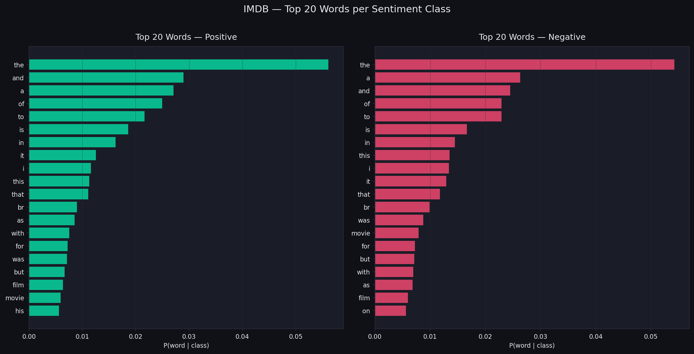

# Naive Bayes from scratch

Gaussian and Multinomial Naive Bayes implemented with NumPy only (no sklearn
classifiers), for the Cognitive Science course.

- **Gaussian NB** on the [Abalone](https://archive.ics.uci.edu/dataset/1/abalone) dataset:
  predicting the age group from physical measurements
- **Multinomial NB** on the [IMDB reviews](https://ai.stanford.edu/~amaas/data/sentiment/)
  dataset: positive/negative sentiment with a bag-of-words model and Laplace smoothing

Both models are run twice, once multiplying raw probabilities and once summing
log-probabilities, to compare the two.




## Running

Download both datasets, set the paths at the bottom of `naive_bayes.py`, then:

```
python naive_bayes.py
```
